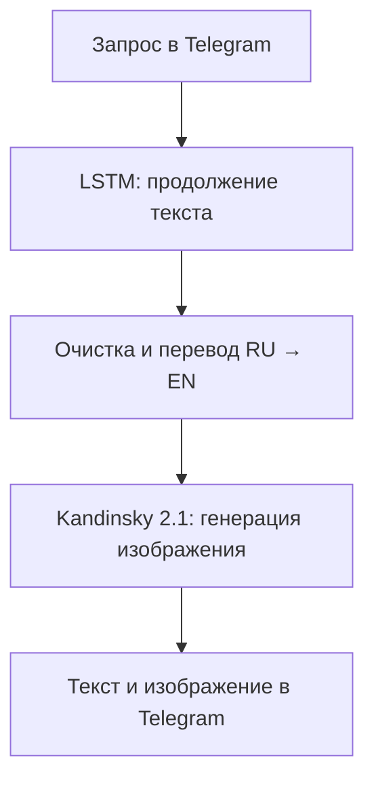

# Генерация изображений через LSTM и Kandinsky 2.1

**Telegram-бот, который превращает короткий запрос в текстовое описание и изображение.** Собственная символьная LSTM дополняет исходную фразу, а предобученная Kandinsky 2.1 визуализирует полученный текст.

Проект разработан в рамках выпускной квалификационной работы. Его идея — использовать неожиданные продолжения языковой модели как источник творческих деталей: пользователю достаточно задать слово или короткую фразу, чтобы получить новую визуальную интерпретацию.

**Стек:** Python · PyTorch · LSTM · Kandinsky 2.1 · pyTelegramBotAPI · NumPy · translators

## Демонстрация

<p align="center">
  
</p>

<p align="center"><em>Пример изображения, опубликованный в репозитории.</em></p>

Пример дополнения запроса из дипломной работы:

> **Запрос:** стул  
> **Сгенерированный текст:** стул удобный деревянный стул подарок с подушкой на сиденье

Продолжение выбирается вероятностно, поэтому результаты для одного запроса могут различаться.

## Возможности

- Генерация описания по русскоязычному слову или фразе.
- Очистка текста и удаление аномалий перед визуализацией.
- Создание изображения с помощью Kandinsky 2.1.
- Выбор разрешения: **512 × 512** или **512 × 768** пикселей.
- Возврат текста и изображения в Telegram.
- Управление командами и кнопками, сохранение выбранного разрешения отдельно для каждого чата.
- Обучение собственной LSTM и сохранение модели, весов и словарей символов.

## Как это работает

Система представляет собой последовательный конвейер из двух генеративных моделей. LSTM обучается предсказывать следующий символ и продолжает пользовательский запрос. Kandinsky получает очищенное и переведённое описание и создаёт изображение.



В рамках проекта «галлюцинация текста» рассматривается как творческое отклонение от исходного запроса. Система может добавлять новые объекты и сочетания признаков, поэтому результат не всегда буквально соответствует введённой фразе.

### Текстовая модель

Архитектура: `Embedding → LSTM → Dropout → Linear`. Модель работает на уровне символов, использует скрытое состояние LSTM и выбирает следующий символ из распределения softmax с температурой.

| Параметр | Значение в коде |
| --- | --- |
| Размер embedding | 256 |
| Размер скрытого состояния | 256 |
| Число слоёв LSTM | 2 |
| Dropout | 0.3 |
| Длина исходного фрагмента для обучения | 512 символов |
| Размер батча | 64 |
| Оптимизатор | Adam, learning rate = 0.001 |
| Функция потерь | CrossEntropyLoss |
| Ограничение нормы градиента | 1.0 |
| Планировщик learning rate | ReduceLROnPlateau |
| Температура генерации | 0.5 |
| Длина продолжения | 60 новых символов |

Цикл обучения предусматривает до **120 000 шагов оптимизации**, проверку средней функции потерь каждые 50 шагов и раннюю остановку после 10 проверок без улучшения. Значение `n_epochs` в скрипте задаёт число итераций со случайным батчем, а не полных проходов по корпусу.

### Генерация изображения

Используется предобученная **Kandinsky 2.1**; её обучение в проекте не выполняется. Параметры вызова в боте: 40 шагов диффузии, `guidance_scale=4`, `batch_size=1`, `sampler='p_sampler'`, `prior_cf_scale=4`, `prior_steps="5"`.

## Данные и результаты

По материалам дипломной работы, исходный корпус включал описания товаров и художественные тексты. После фильтрации его объём составил около **180 МБ**. В репозитории размещён файл `mini_train.txt` размером около **11 МБ**; он представляет отдельный материал для обучения и не равен полному корпусу из отчёта.

| Показатель | Результат, приведённый в дипломной работе |
| --- | --- |
| Итоговая средняя функция потерь LSTM | Около 0.75 |
| Время генерации на GPU | Около 25 секунд |
| Время генерации на CPU | Около 45 секунд |
| Число участников пользовательского опроса | 10 |
| Средняя оценка визуальной привлекательности | 85.4 из 100 |
| Средняя оценка соответствия запросу | 69.5 из 100 |

**Контекст оценки.** Данные взяты из дипломной работы и её приложения с пользовательским опросом. Последние два показателя отражают субъективные оценки участников и не являются метриками точности модели. Время генерации зависит от оборудования и условий запуска. В текущем `Machine.py` Kandinsky загружается на `cuda`; для воспроизведения варианта на CPU необходимо изменить конфигурацию загрузки. Эти результаты не были повторно измерены при подготовке README.

## Состав репозитория

| Файл | Назначение |
| --- | --- |
| [Machine.py](Machine.py) | Telegram-бот, загрузка моделей, генерация текста, перевод и создание изображения |
| [newmodeltrain.py](newmodeltrain.py) | Подготовка символьного словаря и обучение LSTM |
| [model.pt](model.pt) | Сериализованная модель LSTM |
| [modelall.pt](modelall.pt) | Веса LSTM в формате `state_dict` |
| [char_to_idx.pickle](char_to_idx.pickle) | Соответствие символов индексам |
| [idx_to_char.pickle](idx_to_char.pickle) | Соответствие индексов символам |
| [mini_train.txt](mini_train.txt) | Текстовый материал для обучения |
| [requirements.txt](requirements.txt) | Зафиксированные зависимости исходного окружения |
| [image.png](image.png) | Демонстрационное изображение |
| [LICENSE](LICENSE) | Лицензия MIT |

## Локальный запуск

### 1. Подготовка окружения

Для исходной конфигурации нужен NVIDIA GPU с поддержкой CUDA. В отчёте указана видеопамять 12 ГБ, оперативная память 16 ГБ и свободное место на диске 50 ГБ. Также требуется доступ к интернету для Telegram, сервиса перевода и первоначальной загрузки Kandinsky.

Зависимости репозитория относятся к окружению PyTorch 2.0.1 / CUDA 11.8. Для его восстановления можно использовать Python 3.10 в отдельном виртуальном окружении. Совместимость с новыми версиями библиотек отдельно не проверена.

```bash
git clone https://github.com/Melnika2003/diplom.git
cd diplom
python -m venv .venv
```

Активируйте окружение:

```bash
# Linux / macOS
source .venv/bin/activate

# Windows PowerShell
.venv\Scripts\Activate.ps1
```

### 2. Установка зависимостей

Файл `requirements.txt` в репозитории сохранён в UTF-16. Следующая команда создаёт его копию в UTF-8:

```bash
python -c "from pathlib import Path; p = Path('requirements.txt'); Path('requirements-utf8.txt').write_text(p.read_text(encoding='utf-16'), encoding='utf-8')"
```

Установите зависимости с дополнительным индексом для указанной в файле сборки PyTorch:

```bash
python -m pip install --upgrade pip
python -m pip install -r requirements-utf8.txt --extra-index-url https://download.pytorch.org/whl/cu118
python -m pip install pyTelegramBotAPI
```

`pyTelegramBotAPI` необходим для `import telebot`, но отсутствует в исходном `requirements.txt`. Его версия в репозитории не зафиксирована. Список зависимостей содержит Git-ссылки на CLIP и Kandinsky, поэтому для установки также нужен Git. Полный запуск с загрузкой моделей требует проверки в подготовленном GPU-окружении.

### 3. Подключение Telegram-бота

Создайте бота через [@BotFather](https://t.me/BotFather) и получите токен. В текущем коде используется строка `token = '***'`. Перед запуском замените её в `Machine.py` на чтение переменной окружения, добавив импорт `os`:

```python
import os

token = os.environ["TELEGRAM_BOT_TOKEN"]
```

Задайте токен в терминале:

```bash
# Linux / macOS
export TELEGRAM_BOT_TOKEN="ваш_токен"

# Windows PowerShell
$env:TELEGRAM_BOT_TOKEN="ваш_токен"
```

### 4. Запуск

Запускайте бота из корня репозитория: пути к модели и словарям заданы относительно текущей директории.

```bash
python Machine.py
```

При запуске загружаются LSTM, словари символов и Kandinsky 2.1. Бот получает обновления через `infinity_polling()`; настройка webhook не требуется. Первая загрузка графической модели может занять дополнительное время.

## Использование бота

Сначала отправьте **`/start`**: команда создаёт меню и устанавливает разрешение по умолчанию для текущего чата.

| Команда или кнопка | Действие |
| --- | --- |
| `/start` | Открыть меню и установить разрешение 512 × 512 |
| `/help` | Показать справку |
| `/generate стакан` | Сгенерировать текст и изображение по запросу |
| «Генерация изображения» | Перейти к вводу слова или фразы следующим сообщением |
| «Размер изображения» | Открыть выбор разрешения |
| «512x512» / «512x768» | Выбрать размер изображения |
| «Назад» | Вернуться в основное меню |

Обычный текст принимается как запрос после нажатия «Генерация изображения». Для прямого запуска используйте `/generate <текст>`.

## Обучение LSTM

В `newmodeltrain.py` путь к данным по умолчанию задан как `1.txt`. Чтобы использовать размещённый в репозитории текст, измените настройку:

```python
TRAIN_TEXT_FILE_PATH = 'mini_train.txt'
```

Затем выполните:

```bash
python newmodeltrain.py
```

Скрипт строит словари символов, формирует случайные обучающие фрагменты, обучает модель и сохраняет лучший результат по средней функции потерь. Будут записаны `model.pt`, `modelall.pt`, `char_to_idx.pickle` и `idx_to_char.pickle`. Если нужно сохранить опубликованную модель, перед обучением сделайте копию этих четырёх файлов. Используйте модель и словари из одного запуска обучения.

## Ограничения и развитие

Текущая версия — исследовательский прототип. Качество продолжений зависит от корпуса и температуры: возможны повторы, несвязные фразы и смысловые отклонения. Перевод может дополнительно менять детали описания. Символы, отсутствующие в словаре LSTM, вызывают ошибку генерации.

В коде `prediction_len=60` задаёт число **добавляемых** символов; исходный запрос остаётся в тексте. Отдельная обрезка итогового описания до 60 символов не реализована. Выбранное разрешение хранится в памяти процесса, а обработка GPU-задач не выделена в отдельную очередь.

Возможные направления развития:

- Добавить обработку неизвестных символов и проверку длины запросов.
- Организовать очередь генерации и ограничение числа одновременных GPU-задач.
- Зафиксировать полное окружение, включая версию pyTelegramBotAPI.
- Вынести параметры моделей и токен в конфигурацию.
- Сравнить LSTM с трансформерной моделью расширения запросов.
- Добавить выбор визуальных стилей и более подробную оценку качества.

## Что демонстрирует проект

Проект охватывает полный цикл прикладной работы с генеративными моделями: подготовку текстового корпуса, создание и обучение символьной LSTM в PyTorch, управление обучением через scheduler и early stopping, сохранение артефактов и интеграцию с предобученной моделью изображений. Telegram-интерфейс связывает эти компоненты в пользовательский сценарий с выбором разрешения и отправкой результата.

## Автор и лицензия

Автор: [Melnika2003](https://github.com/Melnika2003). Проект выполнен в рамках выпускной квалификационной работы.

Исходный код проекта распространяется под лицензией [MIT](LICENSE). Для внешних моделей и библиотек действуют лицензии их правообладателей.

Связанные проекты: [Kandinsky 2](https://github.com/ai-forever/Kandinsky-2) · [PyTorch](https://pytorch.org/) · [pyTelegramBotAPI](https://github.com/eternnoir/pyTelegramBotAPI)
